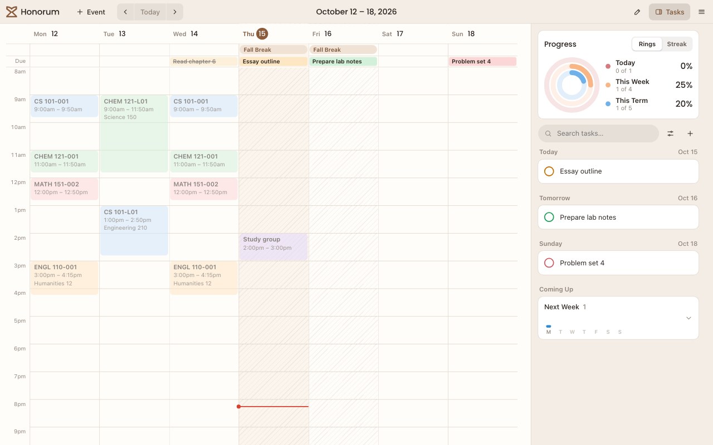
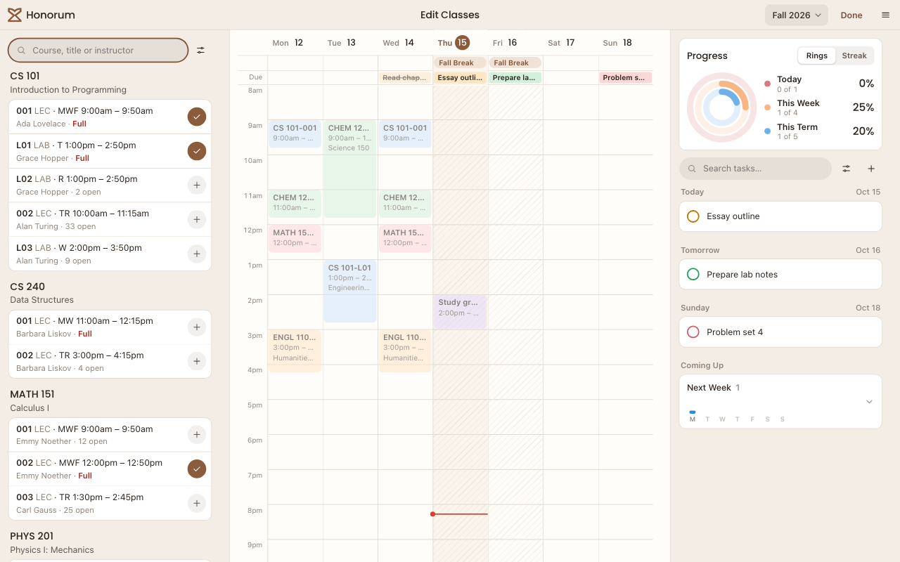

<p align="center">
  <picture>
    <source media="(prefers-color-scheme: dark)" srcset="assets/brand/honorum-logo-reversed.svg">
    
  </picture>
</p>

<h1 align="center">Your term, in view.</h1>

<p align="center">
  A student planner for classes, assignments, and the time between them.<br>
  Accounts are optional. Your saved plans work offline.
</p>

<p align="center">
  <a href="https://honorum.app">Open Honorum</a> ·
  <a href="#run-the-demo">Run the demo</a> ·
  <a href="CONTRIBUTING.md">Contribute</a> ·
  <a href="docs/architecture.md">Architecture</a>
</p>



## What you can do

- **Plan your classes.** Search university catalogs, compare sections, and find schedules without class conflicts.
- **Keep assignments together.** Import Canvas assignments or calendar feeds. Add your own tasks and deadlines.
- **See your week.** Put classes, exams, personal events, and deadlines on one calendar with campus time and holidays.
- **Follow your progress.** Track daily, weekly, and term progress. Account streaks count days that end with nothing overdue.
- **Get reminders.** Receive push notifications for class meetings, deadlines, and open seats.
- **Use an optional account.** Sync across devices, recover conflicting edits, and restore earlier schedule versions.

The repository includes a Svelte web app and a native SwiftUI app for iPhone and iPad.
The Android app is planned in Kotlin and Jetpack Compose.
The backend uses Rust and PostgreSQL.

<details>
  <summary>See class search and section choices</summary>



</details>

All screenshots use fictional courses and tasks from the local demo.

## Run the demo

Install **Rust 1.90 or later**, **Node.js 24**, **Make**, and **Docker or Podman**.
Include the Rust `rustfmt` and `clippy` components.
Use `beta` for the latest development version, including the Rust backend.

```sh
git clone --branch beta https://github.com/HonorumLLC/honorum.git
cd honorum
make setup
make demo
```

Open **http://localhost:18080**.
The demo uses recorded school data and a separate local database for each worktree.
It needs no university account or provider credentials.

For hot reload, run `make dev-api` and `make dev` in separate terminals.
See [development](docs/development.md) for an existing PostgreSQL installation and other build options.

## Check your changes

```sh
npm --prefix apps/web exec -- playwright install chromium
make check
```

This runs Rust, web, edge Worker, and browser checks.
Run `make test-ios` separately on macOS with Xcode.
The [contributor guide](CONTRIBUTING.md) covers forks, task branches, tests, and pull requests.

## Repository map

| Directory | Contents |
| --- | --- |
| [`crates/catalog`](crates/catalog) | Catalog types, provider HTTP client, school adapters, and recorded fixtures |
| [`crates/server`](crates/server) | HTTP API, PostgreSQL, sync, imports, catalog collection, and notifications |
| [`crates/honorum`](crates/honorum) | Server binary and optional embedded web app |
| [`apps/web`](apps/web) | Svelte app, offline storage, browser tests, and performance tools |
| [`apps/ios`](apps/ios) | Native SwiftUI app and its tests |
| [`apps/android`](apps/android) | Native Android project scope; implementation has not started |
| [`contracts`](contracts) | Shared planner fixtures |
| [`assets/brand`](assets/brand) | Logos, icons, and font license |
| [`config`](config) | School configuration |
| [`deploy`](deploy) | Cloudflare edge and DigitalOcean backend deployment |
| [`scripts`](scripts) | Local database wrapper, Git hooks, and capacity tests |
| [`docs`](docs) | Product, development, API, and deployment references |

Each client owns its interface and local storage.
Clients share the HTTP API, planner rules, fixtures, and brand assets.

## Documentation

- [Development](docs/development.md): setup, commands, tests, and performance tools.
- [Application behavior](docs/application.md): planner rules, accounts, privacy, and client interfaces.
- [Architecture and API](docs/architecture.md): backend modules, storage, background work, and endpoint contracts.
- [School adapters](docs/adapters.md): provider support and the steps to add a school.
- [Deployment](docs/deployment.md): configuration, releases, credentials, and recovery.
- [Git workflow](docs/git.md): worktrees, review, branches, and releases.
- [iOS](apps/ios/README.md) and [Android](apps/android/README.md): native client guides.
- [Security](SECURITY.md): private reports of security defects.

Code uses the [GNU AGPL version 3](LICENSE).
Poppins uses the [SIL Open Font License 1.1](assets/brand/OFL-Poppins.txt).
Agent instructions are in [AGENTS.md](AGENTS.md).
